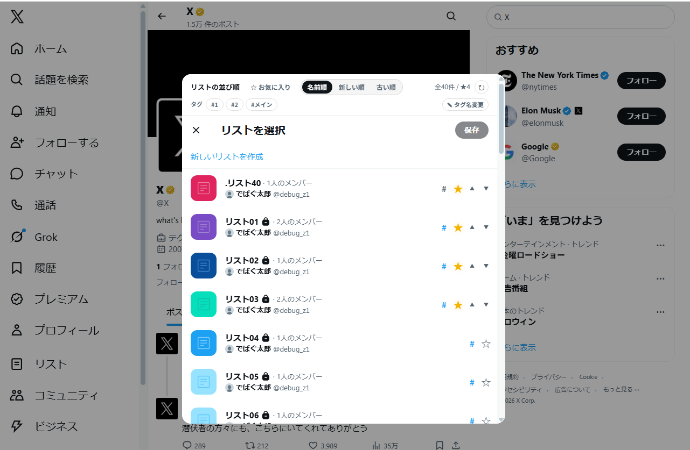
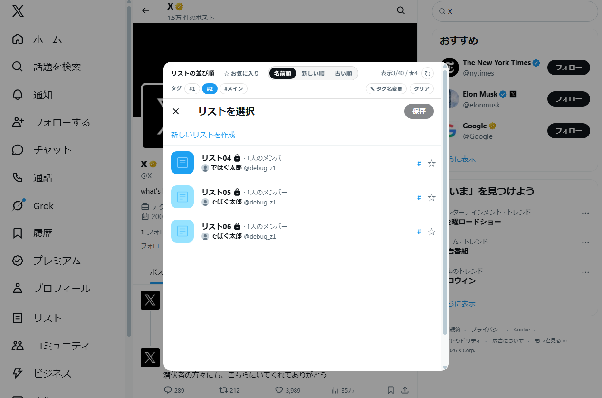

<p align="center">
  
</p>

<h1 align="center">Twitter Better List</h1>

<p align="center">
  X（旧 Twitter）の「リストから追加/削除」画面を、並び替え・お気に入り・タグで使いやすくする Chrome 拡張機能です。
</p>

X の有料 API は使わず、Web クライアントが利用している GraphQL と画面の DOM を利用します。

X Corp. とは関係のない非公式の拡張機能です。X の利用規約に従って、自己責任で使用してください。

## 主な機能

### リスト追加/削除画面

- 名前順 / 新しい順 / 古い順の並び替え
- ☆ お気に入りで絞り込み、★ を先頭に固定（設定可）
- リストごとに #タグ を設定し、タグで絞り込み（OR 条件）
- リスト名・タグを検索（設定で検索欄を表示、初期値 OFF）
- ✎ タグ名変更で同じタグを一括リネーム
- 初回は未取得分をまとめて取得（自動読み込み ON 時）
- 2 回目以降はキャッシュを優先して即表示。右上の ↻ で手動更新
- チェックと「保存」は X の標準機能をそのまま使用

### 自分のリスト一覧 (`/<ユーザー名>/lists`)

- 追加/削除画面と同じ並び替え・お気に入り・タグ絞り込み
- タグフィルターの下にリスト名・タグの検索欄を常時表示
- 各リストの固定ボタン左に # と ☆ を常時表示
- 他のユーザーが作成したリストには「他人が作ったリスト」タグを初回のみ自動付与
- 「新しいリストを見つける」は既定で折りたたみ。設定で非表示に可能

### 左サイドバー

- 「More」内の項目をポストボタン上に展開
- X 標準のナビゲーションと同じ見た目・挙動
- 折りたたみ時はアイコンのみ表示
- Control Panel for Twitter (CPT) の表示設定に追従

### 設定ポップアップ

- 既定の並び順、お気に入り先頭固定
- 未取得リストの自動読み込み ON/OFF
- 追加/削除画面の検索欄 ON/OFF
- サイドバー展開 ON/OFF
- 「新しいリストを見つける」非表示
- リストキャッシュの削除
- お気に入り・タグ・設定のバックアップ / 復元（JSON）

## インストール

1. [Releases](https://github.com/kamuiz-south/Twitter-better-List/releases) から最新の ZIP をダウンロード
   - リリースがない場合は **Code → Download ZIP**
2. ZIP を展開
3. Chrome で `chrome://extensions` を開く
4. 右上の「デベロッパー モード」を ON
5. 「パッケージ化されていない拡張機能を読み込む」で、`manifest.json` があるフォルダを選択
6. X を再読み込み

Chrome 111 以降が必要です。更新後は `chrome://extensions` で拡張機能を再読み込みしてください。

## 使い方

1. X で対象アカウントのプロフィールを開く
2. 「⋯」→「リストから追加/削除」を開く
3. ツールバーで並び替え、# でタグ、☆ でお気に入りを設定
4. チェックを入れて「保存」すると、X の通常処理で追加・削除される

タグはスペースまたはカンマ区切りで複数設定できます。検索欄にはリスト名またはタグを入力でき、スペースで複数語を指定するとすべてを含むリストに絞り込みます。

バックアップは設定ポップアップの「エクスポート / インポート」から行えます。リストキャッシュはバックアップに含まれません。

<p align="center">
  
</p>
<p align="center"><sub>タグで絞り込んだ例</sub></p>

## データとプライバシー

- 設定・お気に入り・タグ・リストキャッシュは `chrome.storage.local` にのみ保存
- お気に入り・タグ・リストキャッシュはログイン中のアカウント単位で保存
- 独自の外部サーバーへの送信は行わない
- 認証情報を独自に外部送信しない
- 追加・削除は X の標準の「保存」に任せる
- 権限は `storage`（保存）、`clipboardWrite`（バックアップのコピー）、x.com / twitter.com へのアクセス（画面への適用）のみ

## 既知の制限

- X の画面構造や GraphQL の仕様変更により、動作しなくなる場合があります
- 自動読み込み ON の初回表示は全件取得のため数秒かかることがあります
- 完全なキャッシュは自動で再確認しません。X 側でリストを変更した場合は **↻** で更新してください
- 未取得リストの自動読み込みが OFF の場合、未取得分は自動で取得されません
- 他のユーザーの公開リストページでは、データが揃うまで一部の行でお気に入り・タグ・新旧順が一時的に使えない場合があります
- X の仮想スクロール画面を展開できない環境では、リストの欠落を防ぐため並び替えを一時停止し、検索とタグ絞り込みのみ適用します（件数の横に `※` を表示）

## 開発

ビルド不要です。`manifest.json` があるフォルダをそのまま読み込めます。

```text
manifest.json
popup.html / popup.css / popup.js
src/main-world.js   X の GraphQL 通信を監視
src/content.js      リスト追加/削除画面
src/lists-page.js   /<ユーザー名>/lists
src/sidebar.js      左サイドバー
src/content.css     注入 UI のスタイル
icons/
```

構文チェック:

```powershell
node --check src/main-world.js
node --check src/content.js
node --check src/lists-page.js
node --check src/sidebar.js
node --check popup.js
```

## ライセンス

[MIT License](LICENSE)

## バージョン

1.0.0
